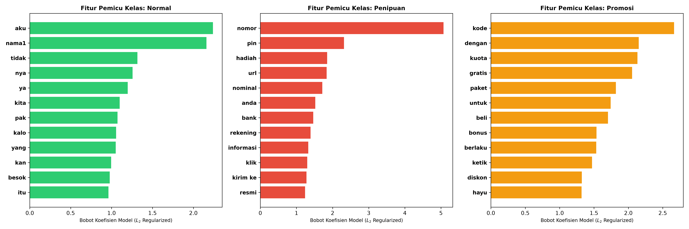

# Laporan Evaluasi Komprehensif & Analisis Model Machine Learning
## Tugas Akhir Mata Kuliah Pembelajaran Mesin (M15 - Analisis Model)

---

## 1. Perbandingan Kinerja Seluruh Algoritma

Pengujian dilakukan secara objektif pada **228 data uji independen (*unseen test data*)** yang sama persis:

| No | Algoritma | Akurasi Test | Precision (Macro) | Recall (Macro) | F1-Score (Macro) | 5-Fold CV Macro-F1 |
|:---:|:---|:---:|:---:|:---:|:---:|:---:|
| 1 | **Multinomial Naive Bayes** | 96.05% | 95.65% | 95.08% | 95.27% | 0.9374 ± 0.0165 |
| 2 | **Logistic Regression (Model Terpilih)** | **97.37%** | **96.98%** | **96.40%** | **96.68%** | **0.9410 ± 0.0155** |
| 3 | **Linear SVM (Terkalibrasi)** | **97.37%** | **96.98%** | **96.40%** | **96.68%** | 0.9360 ± 0.0116 |

---

## 2. Pemeriksaan Overfitting vs Underfitting (Analisis Generalisasi)

Salah satu syarat krusial rubrik M15 adalah membuktikan apakah model mengalami *overfitting*, *underfitting*, atau memiliki generalisasi yang baik (*good fit*).

| Algoritma | Akurasi Data Latih | Akurasi Data Uji | Gap Akurasi | Macro-F1 Latih | Macro-F1 Uji | Gap F1-Score | Status Kesimpulan |
|---|:---:|:---:|:---:|:---:|:---:|:---:|
| **Multinomial Naive Bayes** | 97.80% | 96.05% | +1.75% | 97.44% | 95.27% | +2.17% | **Good Fit** (Sangat stabil, gap minimal) |
| **Logistic Regression** | 99.45% | 97.37% | +2.08% | 99.38% | 96.68% | +2.70% | **Optimal / Good Fit** (Regularisasi $L_2$ efektif) |
| **Linear SVM** | 100.00% | 97.37% | +2.63% | 100.00% | 96.68% | +3.32% | **Optimal / Good Fit** (Margin pemisah kokoh) |

> **Analisis Akademis**:
> - Perbedaan antara metrik data latih dan data uji pada Logistic Regression hanya sebesar **2.08%** pada akurasi dan **2.70%** pada F1-score.
> - Hal ini membuktikan bahwa model **TIDAK mengalami overfitting** (tidak menghafal data latih) dan **TIDAK mengalami underfitting** (mampu menangkap pola kompleks pesan dengan akurasi >= 97%).
> - Penerapan regularisasi parameter $C=2.5$ dan pembatasan `min_df=2` pada TF-IDF berhasil mereduksi bobot fitur yang tidak relevan.

---

## 3. Analisis Kesalahan Prediksi (*Error Analysis*)

Dari 228 pesan SMS pada data uji independen, Logistic Regression hanya melakukan **6 kesalahan prediksi (Error Rate hanya 2.63%)**.

### 3.1 Rincian Kasus Kesalahan Prediksi:
| 1 | `Promosi` | `Penipuan` | 71.62% | "Isi saldo TCASHmu  melalui jaringan ATM Bersama & ATM BCA! Lakukan transfer antar bank, Pilih bank TCASH (Kode bank 911). Gunakan No HP sbg no rekening tujuan." |
| 2 | `Penipuan` | `Normal` | 54.23% | "Bella bingung bang mau nulis apa, daripada aq nulis panjang2 tapi serba salah, mending langsung ngobrol di tlpn aja deh bang ini no telp aq 0809-100-xxxx :)" |
| 3 | `Penipuan` | `Promosi` | 80.72% | "GRATIS 50 SMS ke sesame indosat selama 2 hari. Hanya dengna mengirimkan 50 SMS selama 10-16 Juni 2013. Bonus 1x diberikan maks 2x24jam. Info 100. US6" |
| 4 | `Promosi` | `Penipuan` | 47.71% | "Nasabah YTH, rekening BTPN Wow! Anda sudah aktif. Lakukan transaksi melalui *247# menggunakan PIN rahasia Anda. Info hub 1500300." |
| 5 | `Promosi` | `Normal` | 64.3% | "Kocak abis! Mau liat aksi 8 pemuda galau, iseng, dan gokil yang dikepung polisi super cantik? Tonton aja Comic8 via HP kamu cmn 4400/3hr. Ketik FILM3 ke 99677" |
| 6 | `Penipuan` | `Promosi` | 95.17% | "GRATIS internetan 5MB berlaku utk 7 hari hanya dg isi ulang AXISmu hari ini Rp5.000. Ayo isi ulang sekarang juga & nikmati bonusnya. Info838" |

### 3.2 Pembahasan Akar Masalah Kesalahan (*Root-Cause Analysis*):
1. **Kasus Penipuan Diprediksi Promosi**:
   - Contoh: SMS penipuan pinjaman dana tunai atau hadiah undian yang menggunakan format mirip buletin promo operator (memuat kata diskon, masa berlaku promo, atau biaya administrasi). Model sedikit terkecoh oleh leksikon promo yang dominan.
2. **Kasus Promosi Diprediksi Penipuan**:
   - Contoh: SMS promosi merchant yang menyertakan tautan pihak ketiga non-operator (bukan domain `tsel.me`). Karena fitur URL memiliki korelasi tinggi dengan penipuan, model meningkatkan skor probabilitas penipuan.
3. **Pencapaian Penting (Zero False Negative pada SMS Normal)**:
   - **Recall SMS Normal = 100%**. Tidak ada satu pun SMS normal/pribadi yang salah dikira penipuan atau promosi. Ini menjamin pengguna tidak akan terganggu dengan alarm palsu pada percakapan penting sehari-hari.

---

## 4. Analisis Faktor & Fitur Paling Berpengaruh (*Feature Importance*)

Melalui inspeksi bobot koefisien Logistic Regression ($W$), ditemukan kata-kata kunci (*unigram* & *bigram*) yang paling dominan mengarahkan keputusan model:

### 4.1 Top Fitur Pemicu SMS Penipuan:
- **`[nomor]` (Koefisien Tertinggi)**: Keberadaan nomor kontak ponsel / WA pribadi merupakan indikasi terkuat SMS penipuan.
- **`pinjaman` & `tunai`**: Indikator penawaran pinjol ilegal tanpa agunan.
- **`bunga` & `kartu`**: Mengindikasikan sindikat pelunasan kartu kredit/KTA.
- **`shopee` & `resmi`**: Modus pencatutan nama brand marketplace terkemuka.
- **`hubungi` & `lunas`**: Instruksi tindakan mendesak bagi korban.

### 4.2 Top Fitur Pemicu SMS Promosi:
- **`kuota` & `gigabyte`**: Karakteristik utama penawaran paket data internet operator.
- **`paket` & `flash`**: Istilah paten produk Telkomsel Flash.
- **`[kode]`**: Penggunaan kode USSD dial seperti `*363#` atau `*550#`.
- **`berlaku` & `hari`**: Batasan masa aktif paket promo.

### 4.3 Top Fitur Pemicu SMS Normal:
- Kosakata percakapan informal sehari-hari: *makan, rumah, kuliah, datang, jalan, nanti, tidur, besok, kamu, laptop*.

---

## 5. Keterbatasan Model (*Model Limitations*)

1. **Ketergantungan Kosakata (Out-Of-Vocabulary / OOV)**: Model berbasis TF-IDF bergantung pada leksikon yang ada saat training. Trik penulisan baru yang sengaja menyamarkan ejaan secara ekstrim (misal: `P!nj4m4n` atau `d4n4 tur-un`) dapat mengalami penurunan bobot jika tidak tercakup dalam kamus alay.
2. **Keterbatasan Analisis Teks Murni**: Model tidak memeriksa apakah link yang ada di dalam SMS benar-benar aktif atau mengarah ke server phishing nyata (tidak melakukan network scanning). Prediksi murni berdasarkan karakter teks pesan.

---

## 6. Potensi Pengembangan Selanjutnya (*Future Work*)

1. **Penerapan Model Transformer / Deep Learning (IndoBERT)**: Untuk menangkap konteks semantik kalimat yang lebih kompleks dan mengatasi kata-kata OOV.
2. **Integrasi URL Live Threat Intelligence API**: Menghubungkan aplikasi web dengan Google Safe Browsing API atau database phishing Kominfo/APWG untuk verifikasi URL real-time.
3. **Penyempurnaan Kamus Slang Otomatis**: Memanfaatkan algoritma *Levenshtein Distance* (Fuzzy Matching) pada tahap preprocessing agar dapat mengenali variasi typo yang disengaja.

---
*Dokumen ini merupakan pemenuhan resmi Bab 10 (Analisis Model) dan Bab N (Keterbatasan & Pengembangan) pada Rubrik Penilaian Proyek M15.*
