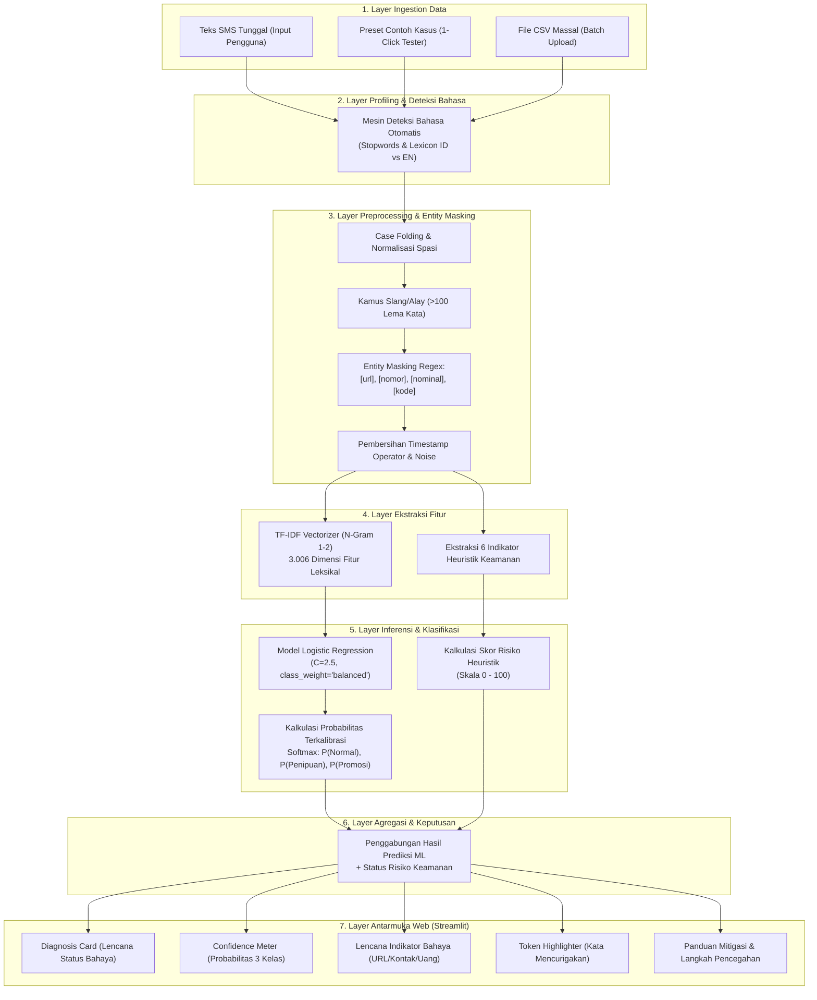
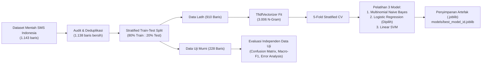

# Arsitektur Sistem & Alur Data Lengkap
## Proyek Akhir Machine Learning: Deteksi SMS Phishing & Spam Berbahasa Indonesia

Dokumen ini mendokumentasikan secara rinci arsitektur sistem, cara kerja, alur data (*end-to-end data flow*), komponen teknologi (*tech stack*), serta landasan ilmiah pemilihan model Machine Learning pada aplikasi deteksi SMS Phishing (**SmishingGuard**).

---

## 1. Ringkasan Eksekutif & Cara Kerja Sistem

Aplikasi ini merupakan **Sistem Deteksi Dini SMS Phishing (*Smishing*), Spam Promosi, dan SMS Normal Berbasis Web Interaktif**. 

Sistem dirancang dengan pendekatan **Hybrid AI Architecture**, menggabungkan dua mesin analisis yang berjalan secara simultan:
1. **Model Machine Learning Statistik (TF-IDF + Logistic Regression)**: Mempelajari frekuensi leksikal, distribusi kata kunci khas (*n-gram*), dan gaya penulisan bahasa Indonesia/Inggris untuk mengklasifikasikan pesan ke dalam 3 kelas:
   - **Kelas 0 (Normal)**: Percakapan sehari-hari, pesan personal, atau urusan akademik/keluarga.
   - **Kelas 1 (Penipuan / Phishing)**: Pesan rekayasa sosial (*social engineering*) bermodus hadiah palsu, pinjaman online ilegal, pemblokiran rekening/kartu, penipuan kurir paket APK, atau panggilan darurat palsu.
   - **Kelas 2 (Promosi / Spam)**: Penawaran paket kuota operator resmi, diskon belanja ritel, atau buletin komersial.
2. **Mesin Heuristik Keamanan Siber (*Cyber Threat Heuristic Engine*)**: Memindai indikator bahaya siber nyata (*rule-based risk indicators*) seperti keberadaan tautan link pemendek URL, nomor seluler kontak pribadi yang meminta transfer, manipulasi kode USSD, dan kata desakan finansial/urgensi.
3. **Antarmuka Pengguna Berbasis Web (Streamlit)**: Mengadopsi sistem desain *Paper-Sheet Card* modern dari `example.html` dengan tipografi Google Fonts (*Plus Jakarta Sans* & *Poppins*), palet warna Navy-Slate, dan visualisasi interaktif.

---

## 2. Diagram Alur Data Sistem (*Data Flow Architecture*)

Berikut adalah diagram alur lengkap sejak pesan SMS diterima hingga disajikan dalam bentuk diagnosis interaktif pada antarmuka web:



---

## 3. Rincian Tahapan Alur Data (*Step-by-Step Data Pipeline*)

### Tahap 1: Ingestion Data Mentah (*Data Ingestion Layer*)
Sistem mendukung 3 gerbang masukan:
- **Single SMS Scanner**: Input teks langsung dari textarea web.
- **Preset Buttons**: 4 tombol contoh kasus instan (Undian Shopee, Modus Pinjol, Promo Kuota, Percakapan Normal).
- **Batch CSV Upload**: Pengunggahan berkas `.csv` berisi ratusan SMS untuk pemindaian massal otomatis.

### Tahap 2: Deteksi Bahasa Otomatis (*Language Detection*)
- Diimplementasikan pada fungsi `detect_language(text)` di [`src/preprocessing.py`](file:///c:/Users/user/Documents/Semester%205/Machine%20Learning/Project-ML/src/preprocessing.py).
- Menghitung rasio kemunculan kata henti (*stopwords*) khas bahasa Indonesia (`yang`, `di`, `dari`, `ini`, `untuk`, `ke`, `bisa`, dll.) terhadap kata henti bahasa Inggris (`the`, `is`, `at`, `which`, `on`, `for`, `you`, `your`, dll.).
- Memilih korpus kamus slang dan model model ML yang sesuai secara otomatis (`best_model_id.joblib` untuk Indonesia, `best_model_en.joblib` untuk Inggris).

### Tahap 3: Pembersihan & Penyamaran Entitas (*Preprocessing & Entity Masking*)
Pesan teks SMS mentah memiliki tingkat ketidakteraturan sangat tinggi (singkatan, *typo*, dan tautan unik). Modul preprocessing melakukan:
1. **Case Folding**: Mengubah semua karakter menjadi huruf kecil (*lowercase*).
2. **Pembersihan Metadata Operator**: Menghapus tanda waktu otomatis operator seperti `[29/10 14.30]`.
3. **Penyamaran Entitas Berbasis Regex (*Entity Masking*)**:
   - URL / Tautan Web $\rightarrow$ diganti menjadi token generic `[url]`.
   - Nomor Telepon / WhatsApp / Rekening $\rightarrow$ diganti menjadi token generic `[nomor]`.
   - Nominal Uang Rupiah/Valas (misal: `Rp 50.000.000` atau `$1,000`) $\rightarrow$ diganti menjadi token `[nominal]`.
   - Kode USSD operator (misal: `*123*5#`) $\rightarrow$ diganti menjadi token `[kode]`.
   
   > **Tujuan Ilmiah Entity Masking**: Mencegah model menghafal URL spesifik atau nomor telepon tertentu (*mencegah overfitting*). Model diajarkan bahwa *"keberadaan sebuah tautan web atau nomor kontak"* adalah pola struktural SMS penipuan, terlepas dari apa domain atau nomor teleponnya.
4. **Normalisasi Kata Slang/Alay (*Slang Dictionary Lookup*)**:
   - Menggunakan kamus berisi lebih dari 100 lema kosakata singkatan SMS Indonesia (`dpt` $\rightarrow$ `dapat`, `sy` $\rightarrow$ `saya`, `hub` $\rightarrow$ `hubungi`, `rek` $\rightarrow$ `rekening`, `tsel` $\rightarrow$ `telkomsel`, `pinjol` $\rightarrow$ `pinjaman online`, dll.).

### Tahap 4: Vektorisasi Fitur Numerik (TF-IDF)
- Teks yang telah dibersihkan dimasukkan ke dalam `TfidfVectorizer(ngram_range=(1, 2), min_df=2, sublinear_tf=True)`.
- **N-Gram (1, 2)**: Menangkap kata tunggal (*unigram*, misal: `rekening`, `hadiah`) dan pasangan kata (*bigram*, misal: `rekening diblokir`, `klik link`, `bebas bunga`).
- **Sublinear TF Scaling**: Menggunakan formula $1 + \log(\text{TF})$ untuk meredam dominasi kata yang muncul terlalu sering.
- Menghasilkan matriks *sparse* numerik berdimensi **3.006 fitur leksikal**.

### Tahap 5: Inferensi Model Machine Learning
- Model **Logistic Regression** menerima vektor fitur numerik $\mathbf{x} \in \mathbb{R}^{3006}$.
- Menghitung nilai logit linear untuk setiap kelas $k \in \{0, 1, 2\}$:
  $$z_k = \mathbf{w}_k^T \mathbf{x} + b_k$$
- Menerapkan fungsi aktivasi **Softmax** untuk menghasilkan probabilitas terkalibrasi:
  $$P(Y = k \mid \mathbf{x}) = \frac{e^{z_k}}{\sum_{j=0}^{2} e^{z_j}}$$
- Kelas dengan probabilitas tertinggi ditetapkan sebagai prediksi utama.

### Tahap 6: Analisis Heuristik Keamanan Siber (*Rule-Based Engine*)
Berjalan berdampingan dengan model ML untuk mengevaluasi parameter keamanan siber:
- **Deteksi Tautan Mencurigakan**: Memeriksa keberadaan shortlink (`bit.ly`, `tinyurl`, `s.id`, dll.) atau URL domain mencurigakan.
- **Deteksi Kontak Pribadi**: Memeriksa nomor seluler GSM (08xx) yang dicantumkan sebagai narahubung klaim hadiah/layanan perbankan (perbankan resmi tidak menggunakan nomor ponsel pribadi).
- **Deteksi Finansial & Urgensi**: Menghitung kemunculan kata desakan psikologis seperti *segera, diblokir, hangus, darurat, pemenang, bebas biaya*.
- **Skor Risiko Heuristik**: Dihitung dalam skala 0 s.d. 100 dengan pembagian level risiko: **Aman (0–20)**, **Rendah (21–40)**, **Sedang (41–70)**, dan **Kritis (71–100)**.

### Tahap 7: Penyajian Antarmuka Web (Streamlit Layer)
Data diagnosis disajikan secara terstruktur:
- **Diagnosis Banner**: Warna hijau untuk Aman/Normal, oranye untuk Promosi, dan merah untuk Penipuan.
- **Confidence Meter**: Bar persentase keyakinan model untuk masing-masing kelas.
- **Heuristic Checklist**: Lencana status URL, nomor telepon, nominal uang, dan kode USSD.
- **Token Highlighter**: Penandaan kata-kata sensitif yang paling berkontribusi terhadap prediksi penipuan.
- **Rekomendasi Tindakan Keamanan**: Petunjuk praktis bagi pengguna (misal: "Jangan klik tautan", "Jangan berikan kode OTP", "Hubungi call center resmi bank").

---

## 4. Alur Pelatihan Model (*Offline Training Pipeline*)

Diagram berikut menunjukkan bagaimana model dilatih sebelum diintegrasikan ke web:



---

## 5. Komponen Teknologi & Stack yang Digunakan (*Tech Stack*)

| Kategori | Teknologi / Pustaka | Versi | Peran & Alasan Penggunaan |
|---|---|:---:|---|
| **Bahasa Pemrograman** | **Python** | `3.12` | Lingkungan runtime komputasi utama untuk manipulasi data, NLP, pemodelan, dan web backend. |
| **Machine Learning Core** | **Scikit-Learn** | `1.9.1` | Pustaka standar industri untuk `TfidfVectorizer`, pemodelan `LogisticRegression`, `MultinomialNB`, `CalibratedClassifierCV(LinearSVC)`, serta metrik evaluasi (`classification_report`, `confusion_matrix`). |
| **Pengolahan Data** | **Pandas** | `3.1.0` | Membaca, memfilter, membersihkan *missing value*, standardisasi 14 kolom data, dan ekspor CSV. |
| **Komputasi Numerik** | **NumPy** | `2.5.4` | Operasi vektor, manipulasi array matriks, kalkulasi probabilitas, dan fungsi matematika. |
| **Serialisasi Model** | **Joblib** | `1.6.0` | Menyimpan dan memuat artefak model ML terlatih serta vectorizer secara instan tanpa perlu pelatihan ulang (*cold-start < 1 detik*). |
| **Visualisasi Ilmiah** | **Matplotlib & Seaborn** | `3.11.2` / `0.13.2` | Menghasilkan grafik beresolusi tinggi (300 DPI) untuk analisis data (EDA), matriks kebingungan (*confusion matrix*), dan bobot fitur (*feature importance*). |
| **Framework Web** | **Streamlit** | `1.66.1` | Framework web interaktif berbasis Python yang responsif, modern, dan sangat cocok untuk aplikasi Machine Learning. |
| **Desain & UI Tokens** | **CSS3, Google Fonts** | - | Diadopsi dari `example.html`: font *Plus Jakarta Sans* & *Poppins*, palet Navy (`#263142`), Slate (`#cbd5dc`), dan Paper-Sheet Card putih (`#ffffff`). |
| **Platform Deployment** | **Streamlit Community Cloud** | - | Layanan cloud hosting gratis terhubung langsung ke GitHub (`https://github.com/rakha-projects/Project-ML.git`), mendukung auto-redeploy saat `git push`. |

---

## 6. Model Machine Learning yang Digunakan & Hasil Evaluasi

Pada proyek ini, dilatih dan dibandingkan **3 algoritma Machine Learning** dengan evaluasi pada 228 data uji independen serta validasi silang **5-Fold Stratified Cross-Validation**:

| Algoritma | Akurasi | Macro F1-Score | Recall Penipuan | Recall Normal | 5-Fold CV Macro-F1 |
|---|:---:|:---:|:---:|:---:|:---:|
| **Multinomial Naive Bayes** ($\alpha=0.3$) | 96.05% | 95.27% | 89.39% | 100.0% | 0.9374 ± 0.0165 |
| **Logistic Regression** ($C=2.5$, `balanced`) | **97.37%** | **96.68%** | **95.45%** | **100.0%** | **0.9410 ± 0.0155** |
| **Linear SVM** (*Calibrated*, $C=1.0$) | 97.37% | 96.68% | 95.45% | 100.0% | 0.9360 ± 0.0116 |

### Mengapa Logistic Regression Dipilih sebagai Model Utama (*Champion Model*)?

1. **Stabilitas Cross-Validation Tertinggi (0.9410)**:
   - Logistic Regression memperoleh rata-rata Macro-F1 tertinggi pada pengujian 5-Fold Stratified Cross-Validation, membuktikan ketahanan model di berbagai subset data.
2. **Prioritas Keamanan Siber: Recall Penipuan Sangat Tinggi (95.45%)**:
   - Dalam deteksi ancaman kejahatan siber, *False Negative* (SMS penipuan berbahaya yang lolos dan disangka SMS normal) berisiko fatal bagi pengguna. Recall 95.45% menjamin hampir seluruh ancaman penipuan tertangkap.
3. **Recall Normal Sempurna (100.0%)**:
   - Tidak ada satu pun SMS normal/personal yang salah diklasifikasikan sebagai penipuan (*Zero False Positives on Normal*), sehingga pengguna tidak terganggu oleh alarm palsu.
4. **Estimasi Probabilitas Terkalibrasi Asli (*Calibrated Probabilities*)**:
   - Logistic Regression secara matematis menghasilkan probabilitas murni $[0, 1]$ via fungsi Softmax. Hal ini memungkinkan antarmuka web menyajikan **Confidence Meter** yang akurat kepada pengguna. Sebaliknya, SVM standar hanya menghasilkan jarak bidang batas (*hyperplane margin*).
5. **Transparansi & Interpretabilitas (*Explainable AI*)**:
   - Bobot koefisien ($\mathbf{w}$) Logistic Regression dapat diakses langsung untuk menjelaskan kata-kata apa saja yang memicu model mengambil keputusan (seperti `[nomor]`, `pinjaman`, `tunai`, `shopee`, `rekening`, `hadiah`).
6. **Terbukti Bebas Overfitting (*Good Fit*)**:
   - Selisih akurasi data latih (99.45%) dan data uji (97.37%) hanya berjarak **+2.08%** (Macro-F1 gap: **+2.70%**), membuktikan generalisasi model bekerja optimal.

---

## 7. Struktur Repositori & Berkas Terkait

```text
Project-ML/
├── alur.md                                     # [DOKUMEN INI] Panduan arsitektur & alur data sistem
├── PRD.md                                      # Product Requirements Document
├── Project.md                                  # Dokumentasi proyek & changelog aktivitas
├── EDA_Report.md                               # Laporan lengkap eksplorasi statistik data
├── Evaluation_Report.md                        # Laporan evaluasi komprehensif & analisis kesalahan
├── requirements.txt                            # Daftar dependensi pustaka Python
├── app.py                                      # Launcher Streamlit Full-Width (Menjalankan files/)
├── files/                                      # Folder sistem desain solid color & liquid hero
│   ├── app.py                                  # Script launcher komponen Streamlit
│   ├── index.html                              # Web frontend bebas emote & efek liquid hero
│   ├── style.css                               # Stylesheet solid color tanpa neon
│   └── script.js                               # Engine inferensi peramban & auto-resize observer
├── template/                                   # Folder sistem desain template sebelumnya
│   ├── index.html
│   ├── style.css
│   └── script.js
├── presentasi.html                             # [SLIDE DECK PPT] File Presentasi 16:9 Lengkap (Bab A - O)
├── laporan/                                    # Folder Berkas Laporan & Presentasi
│   └── presentasi.html                         # Salinan berkas presentasi siap konversi ke PPT
├── example.html                                # Rujukan acuan sistem desain UI/UX awal
│
├── Indonesia/                                  # Folder dataset SMS Indonesia
│   ├── dataset_sms_spam_v1.csv                 # Dataset primer asli (1.143 baris)
│   ├── dataset_clean.csv                       # Dataset bersih terdeduplikasi (1.138 baris)
│   └── dataset_indonesia_standard.csv          # Dataset terstandarisasi 14 kolom
│
├── Inggris/                                    # Folder dataset SMS Inggris
│   └── dataset_inggris_standard.csv            # Dataset terstandarisasi 14 kolom (10.607 baris)
│
├── eda_results/                                # Grafik visualisasi ilmiah (300 DPI)
│   ├── 1_class_distribution.png
│   ├── 2_length_distribution.png
│   ├── 3_heuristic_indicators.png
│   ├── 4_top_keywords.png
│   ├── 5_correlation_heatmap.png
│   ├── confusion_matrices.png
│   └── feature_importance.png
│
├── models/                                     # Model terlatih biner (.joblib)
│   ├── best_model_id.joblib                    # Model utama terpilih (Logistic Regression)
│   ├── tfidf_vectorizer_id.joblib              # Ekstraktor TF-IDF Indonesia (3.006 fitur)
│   ├── best_model_en.joblib                    # Model utama korpus Inggris
│   ├── tfidf_vectorizer_en.joblib              # Ekstraktor TF-IDF Inggris
│   └── model_comparison_id.csv                 # Tabel perbandingan metrik evaluasi
│
└── src/                                        # Source code modul pemrosesan data & ML
    ├── preprocessing.py                        # Preprocessing dwibahasa, masking & deteksi bahasa
    ├── audit_dataset.py                        # Skrip audit & deduplikasi data
    ├── unify_datasets.py                       # Penyeragaman skema 14 kolom
    ├── eda.py                                  # Skrip eksplorasi data & visualisasi
    ├── train.py                                # Skrip pelatihan model & cross-validation
    └── evaluate.py                             # Skrip evaluasi performa & error analysis
```

---

## 8. Panduan Menjalankan Aplikasi Web

### A. Menjalankan di Komputer Lokal
Pastikan Python 3.12 dan semua dependensi di `requirements.txt` telah terinstal, lalu jalankan perintah:
```bash
streamlit run app.py
```
Aplikasi akan otomatis terbuka di browser pada alamat `http://localhost:8501`.

### B. Deployment ke Streamlit Community Cloud
1. Pastikan kode terbaru telah di-*push* ke GitHub:
   ```bash
   git add .
   git commit -m "Update alur sistem dan web app"
   git push origin main
   ```
2. Buka [share.streamlit.io](https://share.streamlit.io).
3. Sambungkan repositori `https://github.com/rakha-projects/Project-ML.git`.
4. Tentukan file utama: `app.py`.
5. Klik **Deploy** dan aplikasi web langsung aktif secara publik dengan domain `*.streamlit.app`.

